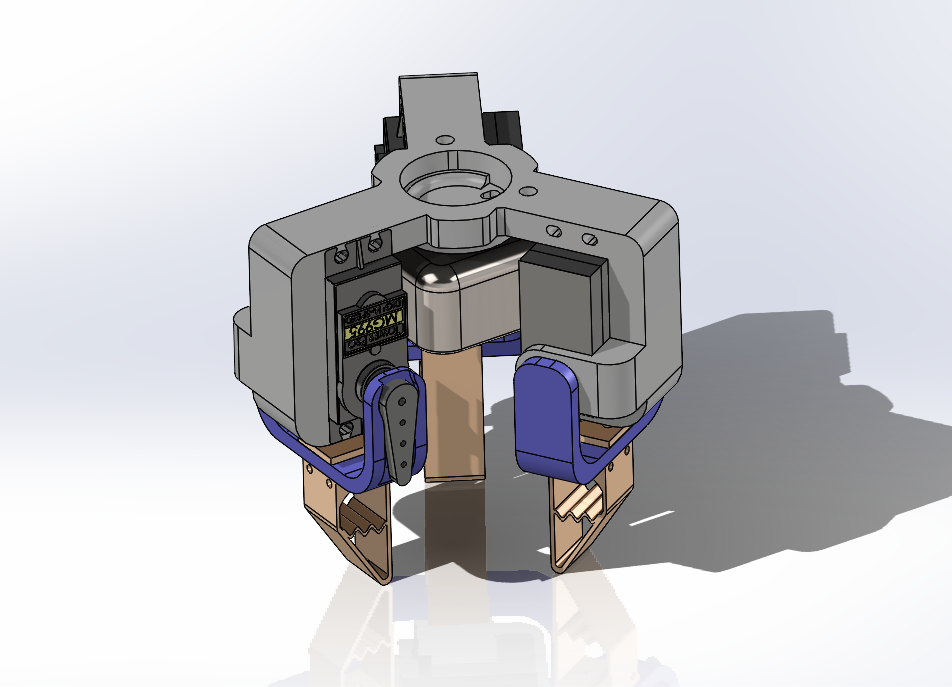

# Three-Finger Adaptive Mushroom Harvesting Gripper

This custom-designed, three-finger robotic gripper is developed for autonomous mushroom harvesting. It features independently servo-actuated fingers that adapt to mushrooms of different sizes and shapes. The gripper provides gentle, controlled grasping to minimize damage to delicate mushroom caps. Its compact design allows integration with robotic manipulators operating in confined mushroom-growing environments.
